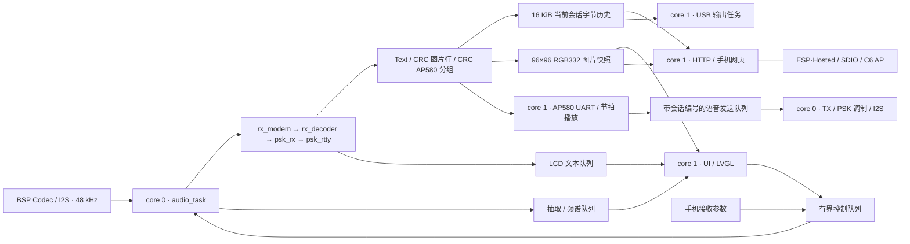

# ESP32-P4 PSK 接收机架构

更新：2026-09-08。当前对外入口是 28 种 PSK/QPSK/8PSK 模式；FT8/FT4、RTTY、CW、MFSK 等旧统一后端代码保留在仓库，本次没有扩展这些模式的产品入口。

## 主要边界

- `audio_input.c` 通过 BSP `esp_codec_dev` 读取音频，48 kHz 经 factor=1 的 DC blocker 送入 modem。音频 task 每块 256 样本，真实采样时间 5.333 ms。
- `rx_modem.c` 是统一 API；`rx_decoder.c` 管后端分发；`psk_rx.c` 管 PSK 配置、调谐和调试快照；`components/psk_rtty` 执行解调与字符解码。
- `psk_modes.c` 是速率、载波数、卷积编码和交织参数来源，包含 HPM 自定义双载波 `2x8PSK1200F`。`modem_image.c` 与 HPM 图片实现相同，`voice_protocol.c` 实现其 AP580 紧凑分组与 CRC。
- `psk_tx.c` 支持有限文本、循环文本、图片字符流和二进制语音流。音频任务串行应用所有控制，TX 任务独占调制器；长度为 1 的覆盖队列传递完整期望配置，避免停止/模式变更被碎片命令覆盖。
- `content_service.c` 管理图片状态及带会话编号的 AP580 队列。UART 任务独占驱动，以 90 / 67.5 / 22.5 ms 节拍输出 600 / 1200 / 2400 档位帧；饥饿时最多重复两帧，UART 整帧发送期限 40 ms。角色、内容或参数切换后丢弃旧会话待发数据。
- `transport.c` 只在短临界区向历史缓存复制字节；`rx_history.c` 是纯 C 环形历史。消费者各持游标，客户端断开或慢读不会阻塞音频线程。历史覆盖是有界缓存策略，丢失数必须可见。
- `rx_web.c` 在 core 1 启动 AP/HTTP。HTTP 参数提交只进入控制队列；实际应用由音频任务串行完成。音频线程每次最多处理 4 个控制事件。队列满时 HTTP 返回 503，成功排队返回 202，状态 API 回报实际已应用的值。
- `rx.html` 完全内嵌固件；不用互联网、CDN 或第三方服务。原始数据只通过 `textContent` 显示，不作为 HTML 解释。每次请求都有时限和重试，重启标识避免混淆旧游标。
- USB 镜像使用单独输出任务，可阻塞等待 USB 驱动，无法阻塞音频任务。部分写入/过慢覆盖计数在状态 API 中公开。
- `display.c` 的 LVGL 任务明确固定 core 1；ESP-Hosted 自身系统任务使用组件默认调度。
- LCD 对齐 HPM6750 `c84c683` 的顶部下拉框和左右分区布局，使用 P4 BSP 触摸驱动。Text 模式先选家族再选具体模式；Image 只列出预计 180 秒以内的模式；Audio 固定模式和 2000 Hz。图片画布与瀑布图存放 PSRAM，图片只在版本变化时重绘。
- 内容切换会重置解码和应用状态，并推进单调递增的会话编号。历史读指针不能越过当前会话起点读取旧内容；HTTP 字节、图片响应带 `X-Content-Epoch`，浏览器拒绝与当前状态不一致的响应。

## API

| 路径 | 方法 | 内容 |
| --- | --- | --- |
| `/` | GET | 离线接收页面 |
| `/api/modes` | GET | 模式 ID、名称、`image_allowed` |
| `/api/status` | GET | 实际模式/频点、内容/角色/会话、图片与语音状态、处理负载、采样/错误统计、heap |
| `/api/rx?cursor=N` | GET | 最多 1024 字节；Text 原始字节、Image 行协议、Audio 校验后还原的 16 B 帧；响应带游标、丢失数、boot/epoch |
| `/api/image` | GET | 当前 96×96 图片的 24 位 BMP；短临界区复制后在锁外编码和发送 |
| `/api/config` | POST | `application/json`：`{"mode":27,"tone_hz":2000,"content_type":1}`；内容 0/1/2 为 Text/Image/Audio，应用后进入 RX |

热点默认 `ESP32P4-PSK` / `pskmodem32`，地址 `192.168.4.1`，最大 4 个客户端。没有 captive portal 自动弹窗。

## 性能和内存

K<=7 的 Viterbi metric 在内部 512 B 工作区，survivor 使用紧凑的内部 3 KiB 环形区。K13/K16 的两个分支共用一个目标向量，三组 64 KiB metric 全部放片内 SRAM；大 survivor 留在 PSRAM。分支由同一个音频任务串行执行，共享工作区不支持并发的多个接收器实例。

P4 PIE 向量指令加速完整 trellis 的 ACS；每 4 个输入对统一扫描和归一化，保持逐状态判决与相等度量时的分支选择。交织逆变换使用等价的环形延迟。K16 使用分数符号定时，自动分支锁定后通过卷积校验关系监测相位失锁并重新捕获；FEC 8PSK 按连续相位距离生成软信息。双载波定时用约 20 符号的包络平均，定时与星座判决均采用相邻两个基带样本的平均。

包含旧模式大工作区的 `s_audio_modem`、两个 32 KiB TX 准备缓存放 PSRAM；L2 保持 128 KiB，ESP-Hosted 优先使用可 DMA 的 PSRAM 池。最终固件实物接收时可用内部 heap 约 127360 B（124 KiB），最大连续块 76 KiB。内部静态余量与运行时 heap 是不同指标。

网页的 DSP 负载以处理时间 / 被处理音频时长计算，不是整个芯片 CPU 占用；最慢块与累计超预算不能单独证明 DMA 无丢样。当前 BSP 不公开硬件 I2S 溢出计数。需要结合 48000 samples/s 的持续采集以及完整载荷对比判断。

最新实测与验证边界见 [三模式联合测试与优化](docs/PSK_LINK_OPTIMIZATION_2026-09-08.md)，速率预算见 [初始评估](docs/RATE_AND_AP_2026-09-07.md)。
